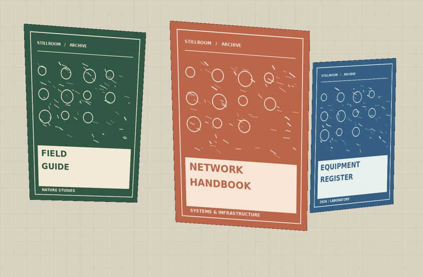

# stillroom
### A local visual asset register for labs, offices and shared spaces

Stillroom lets you register items with reference photographs, find similar inventory records using an existing picture, and search a room/shelf photograph for distinctive registered items. The interface is a clean, responsive application. Everything is processed and stored on your own computer.



## What it does

- **Collection:** item name, category, storage location, notes and a reference photo. Search, add and remove items.
- **Visual search:** upload an existing photo and rank the collection by ORB local matching, HSV colour histograms and simple structural similarity. Reports matching features and a **heuristic ranking score**, not an accuracy claim.
- **Scene scan:** upload an existing room photograph. The app attempts to locate **known, relatively flat and visually detailed** reference items using ORB feature matching, a ratio test and RANSAC homography. Verified matches are overlaid on the scene.
- **Demo kit:** three generated reference labels and a composite scene, useful for a guaranteed, reproducible presentation demonstration.

### Mac: easiest way to start

1. Install [Python 3.10 or newer](https://www.python.org/downloads/) if not already installed. Python 3.11 or 3.12 is recommended.
2. Unzip the project folder.
3. In Terminal, navigate to the folder, for example `cd ~/Downloads/stillroom`.
4. Run:

```bash
chmod +x start.command
./start.command
```

The script creates `.venv` and installs required Python packages on the **first run** (internet connection needed). The app opens in a browser at **http://127.0.0.1:8787**. Leave Terminal running. Press **Ctrl+C** to stop.

macOS Gatekeeper may restrict double-clicked scripts downloaded from the internet. Using Terminal with `./start.command` avoids relying on double-click execution.

### Windows / Linux

```bash
python -m venv .venv
# Windows PowerShell:
.venv\Scripts\Activate.ps1
# macOS/Linux:
# source .venv/bin/activate
pip install -r requirements.txt
python app.py
```

Open **http://127.0.0.1:8787**.

### Optional demo setup

From the project folder, while the environment is active:

```bash
python make_demo.py
```

This populates three *synthetic* records and creates these photos in the `demo/` folder:
- `demo/reference_1.jpg`, `demo/reference_2.jpg`, `demo/reference_3.jpg`
- `demo/sample_scene.jpg` (all three references together, at various sizes and angles)

**Demo order:** 1. Overview → show the collection. 2. Visual search → upload `demo/reference_2.jpg`; confirm the corresponding item appears first. 3. Scene scan → upload `demo/sample_scene.jpg`; matching reference items are outlined. 4. Move to **How it works** to explain ORB, descriptors, nearest-match ranking, RANSAC and the difference between recognition and general detection.

To catalog your *own* objects, click **Add an item** and attach a clear reference photo, ideally a flat textured cover, identifiable printed label, or packaging. For scene scan, include that same object in a larger photo. Uploaded photographs work without a webcam.

## Real-world use cases

- Locating a printed maintenance log or manual in a photographed storage area.
- Recognizing a specific labeled equipment box in an office or computer lab.
- Finding the item record for a product by photographing its distinctive packaging.
- Keeping a searchable photo catalog of shared equipment and supplies.

## Honest limitations

1. **Not general-purpose object detection.** This is a reference-based recognition system. It does not automatically detect categories like arbitrary people, chairs or bottles. YOLO, as covered in Unit 7, is a different family of detectors.
2. ORB matching and homography are most appropriate for roughly flat textured items, e.g. book covers, boxes with labels, and posters. They can fail on smooth surfaces, large viewpoint changes, blurry photos or severe occlusion.
3. Visual search ranks items heuristically; `90/100` is **not** a 90% probability or measured accuracy.
4. A scene scan with no matches does not establish that an item is absent.
5. Only an authenticated/trusted local user should run this app. It binds to `127.0.0.1`, with no accounts; do not expose it publicly.
6. Image formats are supported according to installed Pillow decoders. Convert iPhone HEIC photos to JPG/PNG if your build does not support HEIC.
7. Images and catalog data are stored locally in `data/`. Back up this folder to preserve your records.
8. Google Fonts are an *optional* cosmetic online request; the interface has local font fallbacks and its features work offline after dependencies are installed.

## Technical notes

- Backend: Python, FastAPI, OpenCV, Pillow, SQLite.
- Frontend: HTML/CSS/vanilla JavaScript, no Node build required.
- Endpoints: `GET /api/items`, `POST /api/items`, `DELETE /api/items/{id}`, `POST /api/search`, `POST /api/scan`, `GET /api/health`.
- Interactive OpenAPI documentation: `http://127.0.0.1:8787/api/docs`.
- Visual matching: ORB feature extraction → Hamming descriptor match → Lowe-style ratio filter → RANSAC homography (scene scan).

## Unit 7 ties

| Presentation topic | Demo |
|---|---|
| Image representation | ORB local descriptors; HSV histogram |
| Object recognition | Match saved references to new photographs |
| Template/feature matching | ORB as a more robust feature-based alternative |
| Nearest-neighbour | Rank known records by visual similarity |
| RANSAC | Reject inconsistent matches and project reference corners |
| Bounding boxes / localization | Polygon outline based on a geometric transform |
| Recognition vs general detection | Explain why this is *not* pretrained YOLO detection |

For a classroom evaluation: prepare positive and negative query/scene pairs. Count true/false matches and misses, state your test conditions and thresholds, and do not describe these example outputs as measured accuracy.
